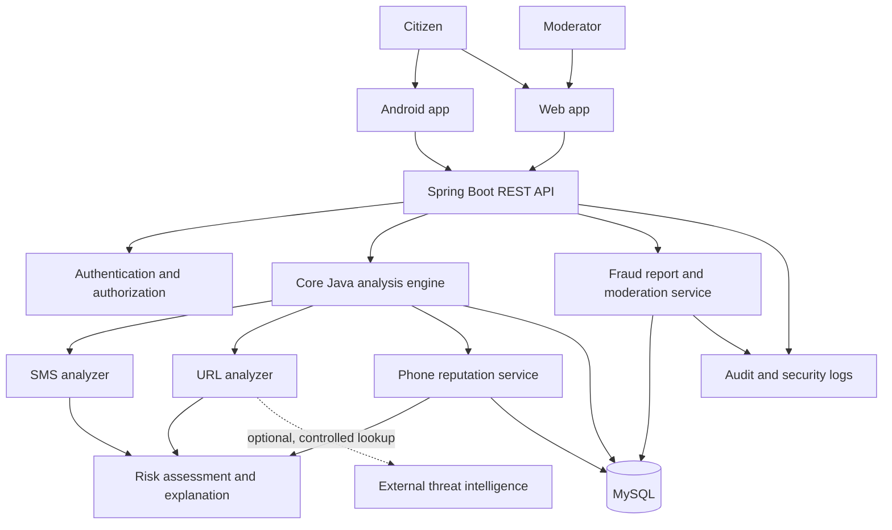
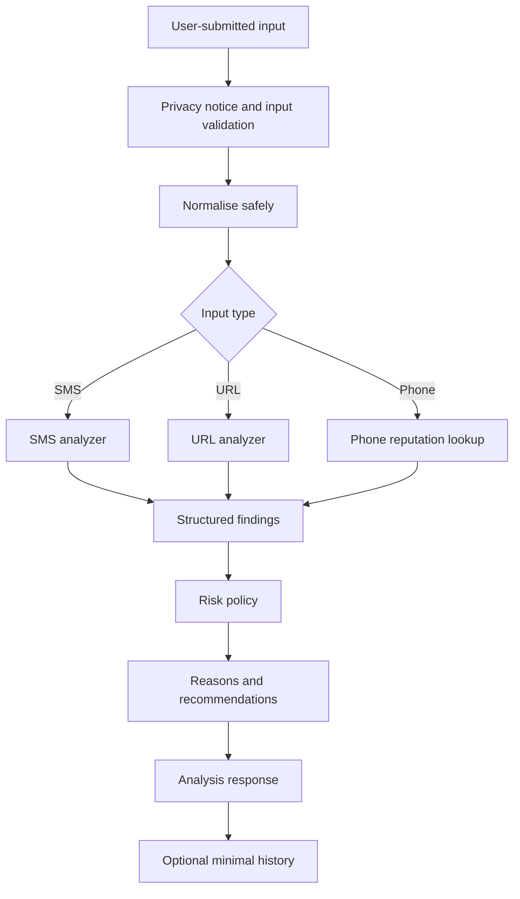

# Mana Suraksha — System Design

> **Document status:** Proposed system design / implementation blueprint. This document describes the target design; it does not claim that the system is already implemented.
>
> **Target stack:** Java 17+, Maven, Spring Boot, MySQL, Android (Java-first learning implementation), HTML/CSS/JavaScript web client.
>
> **Primary quality goals:** explainable warnings, privacy by default, safe failure behaviour, accessible Telugu/English UX, and clear separation between community reports and verified threat intelligence.

## 1. Problem statement and goals

People receive deceptive SMS messages, phishing links and scam calls that impersonate banks, government departments, delivery services or other trusted organisations. Mana Suraksha helps a user inspect an item and understand safer next steps.

### Goals

- Analyse user-submitted SMS text, URLs and phone numbers.
- Return a risk category with evidence-based reasons and recommendations.
- Let users submit suspected-fraud reports and track review status.
- Provide a moderator workflow before community reports become trusted indicators.
- Support Telugu and English.
- Offer Android call-screening integration only within Android's supported permissions and role model.

### Non-goals

- Prove the identity of a caller from caller ID alone.
- Guarantee that every scam is detected.
- Guarantee that an item marked "no known threat" is safe.
- Read all SMS/WhatsApp content in the background.
- Automatically file a government complaint without an authorised integration.
- Replace banks, telecom operators, law enforcement or official cybercrime reporting channels.

## 2. Context and high-level architecture



### Component responsibilities

| Component | Responsibility |
| --- | --- |
| Android client | Localised UI, share-to-check, user-consented call-screening integration |
| Web client | SMS/URL/phone checks, reports and moderator console |
| REST API | Request validation, authentication, rate limiting and orchestration |
| Core Java engine | Deterministic analyzers, risk policy and explanation generation |
| Report service | Report lifecycle, evidence references, moderation and abuse controls |
| MySQL | User, analysis metadata, threat indicators, reports and audit metadata |
| Threat intelligence adapter | Optional external reputation lookups with timeouts and source attribution |
| Audit service | Security-sensitive actions and moderator decisions |

## 3. Logical layers

1. **Presentation layer:** Android and web clients. They do not contain authoritative threat-verification logic.
2. **API layer:** Spring Boot controllers and request/response DTOs. Validate every input.
3. **Application layer:** use-case services such as AnalyzeSms, AnalyzeUrl, CheckPhone, SubmitReport and ReviewReport.
4. **Domain layer:** Core Java models, analyzer interfaces, risk policy, report state machine and business rules.
5. **Infrastructure layer:** repositories, MySQL, external intelligence adapters, logging and secure evidence storage.

The Core Java domain should be buildable and testable without Spring or a database. Spring adapters connect it to external systems.

## 4. Core Java domain model

### Main interfaces and classes

| Type | Responsibility |
| --- | --- |
| `ThreatAnalyzer<T>` | Common contract for an analyzer |
| `SmsAnalyzer` | Extracts suspicious SMS indicators |
| `UrlAnalyzer` | Parses URL and extracts domain/URL indicators without navigating to it |
| `PhoneReputationAnalyzer` | Looks up approved reputation and report status |
| `RiskAssessmentService` | Applies the risk policy to findings |
| `AnalysisResult` | Risk level, score, reasons, recommendations and limitations |
| `ThreatIndicator` | A typed, sourced and time-bounded threat signal |
| `FraudReport` | User-submitted suspected-fraud report |
| `ReportModerationService` | Applies report review and state transitions |
| `SafetyRecommendationProvider` | Returns localised next steps |

Suggested generic contract:

```java
public interface ThreatAnalyzer<T> {
    AnalysisResult analyze(T input);
}
```

Suggested domain types:

- `RiskLevel`: `LOW`, `SUSPICIOUS`, `HIGH`, `UNKNOWN`.
- `VerificationStatus`: `VERIFIED`, `COMMUNITY_REPORTED`, `UNVERIFIED`, `UNKNOWN`.
- `ReportStatus`: `SUBMITTED`, `UNDER_REVIEW`, `NEEDS_INFORMATION`, `VERIFIED`, `UNVERIFIED`, `DUPLICATE`, `CLOSED`.
- `InputType`: `SMS`, `URL`, `PHONE`.
- `IndicatorType`: `URGENT_THREAT`, `CREDENTIAL_REQUEST`, `PAYMENT_PRESSURE`, `SUSPICIOUS_DOMAIN`, `KNOWN_MALICIOUS_DOMAIN`, `REPORTED_PHONE`, etc.

Use composition for combining analyzers. Avoid deep inheritance hierarchies. Use enums for finite states and immutable result objects where practical.

## 5. Analysis pipeline

### General pipeline



### SMS analyzer

Possible indicators include:
- Pressure to act immediately or threats of account closure.
- Requests for OTP, PIN, password, card security code or remote access.
- Requests to install an app or share a screen.
- Unexpected payment, fee or refund instructions.
- Impersonation language and suspicious contact details.
- URLs or phone numbers embedded in the message.

Rules must be contextual. A message containing the word "OTP" is not automatically fraudulent; a request to disclose an OTP to an unknown person is a stronger indicator. Do not log raw message content by default.

### URL analyzer

- Parse using a standards-aware URI parser; reject malformed or unsupported schemes.
- Allow only expected web schemes for reputation checks.
- Normalise hostname carefully; preserve the original for display.
- Inspect punycode/IDN, lookalike characters, misleading subdomains, IP-literal hosts, user-info fields and suspicious ports.
- Compare domain against approved threat intelligence.
- Do not automatically visit the URL, execute scripts, download files or follow redirects in the initial design.
- If later redirect analysis is added, use a hardened isolated service with SSRF protections, DNS/IP validation at every hop, private-address blocking, strict timeouts and no credential forwarding.

### Phone reputation analyzer

- Normalise phone numbers with a recognised numbering library and region context; do not assume every input is Indian.
- Query only approved indicators and moderated report aggregates.
- Return reputation source, last-verified time and status.
- A reported number is not proof that the current caller is fraudulent; caller ID spoofing makes identity inference unreliable.
- Do not expose reporter identities or raw private report content.

## 6. Risk scoring and explainability

The initial score is a policy output, not a statistical probability that fraud occurred.

Illustrative categories (must be calibrated with a labelled dataset):

| Score | Display label | Interpretation |
| --- | --- | --- |
| 0–29 | No known threat / low indicators | No strong signal found in the checks performed |
| 30–69 | Suspicious | One or more concerning signals; verify independently |
| 70–100 | High risk | Multiple strong signals or a trusted high-confidence threat match |

An explicit `UNKNOWN` or `UNABLE_TO_CHECK` outcome is required when analysis is incomplete. Do not force every request into a numeric band.

### Risk policy principles

- A trusted, current malicious-domain match can be a strong signal.
- A keyword match alone should not determine the result.
- Community reports should be weighted below independently verified threat intelligence.
- Stale or unavailable intelligence must be disclosed.
- Keep the policy version with each analysis result for reproducibility.
- Record matched rule IDs and safe explanation codes, not secrets or full private message contents.
- Evaluate false positives and false negatives. Provide a user correction/appeal path.

## 7. Main data model

### Tables

| Table | Important fields |
| --- | --- |
| `users` | `id`, `display_name`, `phone_hash` (optional), `preferred_language`, `created_at`, `status` |
| `roles` | `id`, `role_name` |
| `user_roles` | `user_id`, `role_id` |
| `analysis_history` | `id`, `user_id` nullable, `input_type`, `risk_level`, `risk_score` nullable, `policy_version`, `created_at` |
| `analysis_findings` | `id`, `analysis_id`, `rule_code`, `severity`, `explanation_code` |
| `threat_indicators` | `id`, `indicator_type`, `indicator_hash`, `verification_status`, `source_type`, `source_reference`, `first_seen_at`, `last_verified_at`, `expires_at` |
| `fraud_reports` | `id`, `reporter_user_id`, `category`, `description_redacted`, `status`, `created_at`, `updated_at` |
| `report_evidence` | `id`, `report_id`, `evidence_type`, `secure_object_reference`, `content_hash`, `created_at` |
| `report_votes` | `id`, `report_id`, `user_id`, `vote_type`, `created_at` |
| `moderation_actions` | `id`, `report_id`, `moderator_user_id`, `action`, `reason_code`, `created_at` |
| `audit_events` | `id`, `actor_user_id` nullable, `event_type`, `target_type`, `target_id`, `created_at` |

### Relationships

- User 1 — many analysis history records.
- Analysis 1 — many findings.
- User 1 — many fraud reports.
- Fraud report 1 — many evidence references and moderation actions.
- User many — many roles through `user_roles`.
- User many — many report votes through `report_votes`.
- Threat indicators are independent of reports; moderation explicitly promotes an indicator to a verified state.

### Data protection

- Do not store SMS bodies or full URLs by default. URLs may contain authentication tokens or personal query parameters.
- Do not collect OTPs, passwords, PINs, card data or banking credentials.
- Use keyed hashes for lookup identifiers where feasible; protect keys outside the database.
- Avoid storing full phone numbers unless necessary and consented. Apply retention and access controls.
- Store uploaded evidence in private object storage, not a public web directory. Restrict file types and sizes, scan files and enforce short retention.
- Encrypt transport and sensitive stored data; keep secrets outside source control.
- Provide retention, deletion and user-access procedures.
- Do not expose personal reporter details in public threat lookups.

## 8. API design

Base path: `/api/v1`.

| Method | Endpoint | Purpose | Access |
| --- | --- | --- | --- |
| POST | `/analysis/sms` | Analyse supplied SMS text | Public/rate-limited or authenticated |
| POST | `/analysis/url` | Analyse a URL | Public/rate-limited or authenticated |
| POST | `/analysis/phone` | Check number reputation | Public/rate-limited |
| POST | `/reports` | Create a report | Authenticated |
| GET | `/reports/{reportId}` | View own report and timeline | Owner/moderator |
| GET | `/reports/mine` | List own reports | Authenticated |
| POST | `/reports/{reportId}/evidence` | Attach optional evidence | Owner/moderator |
| GET | `/safety-guides/{guideCode}` | Read localised guidance | Public |
| GET | `/moderation/reports` | Queue of reports | Moderator |
| PATCH | `/moderation/reports/{reportId}` | Record review decision | Moderator |
| GET | `/health` | Health status | Restricted operational endpoint |

### Example SMS request

```json
{
  "messageText": "Your account will be blocked. Share your OTP immediately.",
  "language": "en"
}
```

In production, the client should warn users to remove secrets before submission. Request bodies must be excluded from application logs.

### Example analysis response

```json
{
  "analysisId": "generated-id",
  "inputType": "SMS",
  "riskLevel": "HIGH",
  "riskScore": 82,
  "verificationStatus": "UNVERIFIED",
  "reasons": [
    {
      "code": "URGENT_ACCOUNT_THREAT",
      "messageKey": "analysis.reason.urgent_account_threat"
    },
    {
      "code": "OTP_DISCLOSURE_REQUEST",
      "messageKey": "analysis.reason.otp_disclosure_request"
    }
  ],
  "recommendations": [
    "Do not share your OTP, PIN or password.",
    "Verify using your bank's official app or independently obtained contact details."
  ],
  "limitations": [
    "This is an automated risk assessment, not proof of sender identity."
  ],
  "policyVersion": "1.0"
}
```

### API conventions

- Use DTOs; never expose database entities directly.
- Validate input length, type, format and content.
- Use consistent error response structures.
- Use appropriate HTTP status codes: 400 invalid input, 401 unauthenticated, 403 forbidden, 404 missing resource, 409 state conflict, 429 rate limited and 5xx unexpected server errors.
- Apply rate limits and abuse controls to public analysis/report endpoints.
- Enforce ownership and role checks on every report and moderation operation.

## 9. Android call and message integration

### SMS

The first version uses explicit user action: paste text or share selected text into Mana Suraksha. Broad inbox-reading permissions are not required. Any later SMS permission request must be separately justified against Android platform and app-store policy requirements.

### Calls

Use Android's supported call-screening framework only after the user explicitly enables the app as the call-screening service where the OS permits it. Explain required permissions and behaviour. Provide a safe default: warn first; allow user-configured silencing/rejection only for sufficiently trusted signals. Do not claim access to SIM signalling or guaranteed carrier-level identity verification.

### Platform limitations

- Incoming-call screening support varies by Android version, device and role eligibility.
- A web browser cannot inspect or reject SIM calls.
- Caller ID spoofing can cause a fraudulent call to appear to come from a known number.
- A number can be reassigned or reported incorrectly; reputation must expire and be reviewable.

## 10. Security design and threat model

| Threat | Mitigation |
| --- | --- |
| Malicious input / injection | Parameterised queries, strict validation, output encoding |
| SSRF through URL checking | No auto-fetch in v1; hardened isolated fetcher only if later required |
| Account takeover | Secure authentication, rate limits, session/token protection |
| Report spam / brigading | Rate limits, duplicate detection, reputation controls, moderation |
| False accusation of a number | Separate community reports from verified indicators; appeals and expiry |
| Evidence upload malware | Private storage, size/type limits, scanning and access control |
| Sensitive data leakage | Data minimisation, redaction, log filtering and retention limits |
| Admin misuse | Least privilege, audit events and reviewable moderation decisions |
| Threat-feed outage | Timeout, cache expiry and explicit unknown/incomplete result |
| Caller ID spoofing | Display uncertainty; never treat number match as caller identity proof |

## 11. Reliability, performance and operations

- Keep deterministic local analysis available if external threat intelligence is down.
- Set timeouts and circuit breakers for external services.
- Cache only time-bounded reputation data and retain source timestamps.
- Use database indexes on report status/time, user/report relationships and indicator lookup hashes.
- Paginate reports and analysis history.
- Make report submission idempotent where appropriate to avoid duplicate submissions on retries.
- Use structured logs with correlation IDs; do not log raw message bodies, full URLs, credentials or evidence.
- Add metrics for API latency, analysis outcomes, provider availability, report review time and false-positive feedback.
- Back up database data and test restore procedures.
- Store configuration and secrets in environment-specific secret management, never in Git.

## 12. Testing strategy

### Core Java unit tests

- SMS urgency and credential-request rules.
- Benign messages containing security-related words.
- URL parsing, malformed input, Unicode/punycode and deceptive hostnames.
- Phone-number normalisation for different regions.
- Risk-policy boundaries and unknown outcomes.
- Report state transitions and invalid transitions.
- Telugu/English message-key coverage.

### Integration tests

- REST validation and response contracts.
- Database persistence and transaction boundaries.
- User ownership and moderator permissions.
- Threat intelligence timeout and failure behaviour.
- Rate limiting and duplicate report handling.

### Security and usability tests

- No sensitive content in logs.
- No unauthorised evidence access.
- Upload validation and abuse resistance.
- Screen-reader/large-text and low-connectivity checks.
- Telugu translation review by fluent speakers.
- Android call-screening behaviour on supported devices and OS versions.

Use labelled synthetic examples for tests. Do not publish real victims' messages, phone numbers or private evidence.

## 13. Deployment topology

Initial learning deployment can be a single Spring Boot service and managed MySQL database, with static web hosting and an Android build distributed for testing. Keep evidence storage private and separate. Use HTTPS, environment-specific configuration, database migrations, backups and monitoring.

Scale only when measured usage requires it. Start as a modular monolith rather than microservices; the analyzers and report service remain separate packages/modules with clear interfaces.

## 14. Architecture decisions

| Decision | Reason |
| --- | --- |
| Modular monolith first | Easier to build, test and explain as a solo portfolio project |
| Core Java engine independent of Spring | Demonstrates Java fundamentals and enables fast unit testing |
| Android + web clients | Supports mobile-first villagers and assisted desktop use |
| Explicit SMS sharing in v1 | Reduces permissions and privacy risk |
| User-consented Android call screening | Respects platform restrictions and user control |
| MySQL relational model | Reports, users, evidence and moderation have clear relationships |
| Verified/community/unknown states | Reduces false accusations and overconfident warnings |
| Explainable rules before ML | Easier to validate, test and discuss in interviews |

## 15. Interview walkthrough

**Problem:** People may not recognise impersonation, phishing and scam calls.

**Solution:** Mana Suraksha provides bilingual checks, explainable risk assessments, reporting and safety guidance.

**Architecture:** Android and web clients call a Spring Boot API. The API delegates to a framework-independent Core Java engine. The engine runs type-specific analyzers and a shared risk policy. MySQL stores user/report metadata and moderated threat indicators.

**OOP:** `ThreatAnalyzer<T>` is an interface implemented by SMS, URL and phone analyzers. Composition combines findings. Encapsulation protects domain state. Enums represent risk and report states. Custom exceptions represent invalid input and invalid state transitions.

**Collections:** Lists hold findings/recommendations, maps index rules and translations, sets remove duplicate indicators. Persistent data belongs in MySQL rather than in-memory collections.

**Exception handling:** Validate expected bad input at boundaries, use domain exceptions for invalid operations, map errors to safe API responses and log correlation IDs without sensitive content.

**Multithreading:** Use bounded asynchronous tasks for independent external reputation lookups only when needed; apply timeouts and deterministic aggregation. Do not create one thread per request.

**Database:** Foreign keys preserve relationships; indexes support indicator and report lookups; transactions protect report and moderation updates.

**Security:** Least privilege, rate limits, safe URL handling, private evidence storage, minimal collection and moderator audit trails.

**Current status:** This is the design blueprint. During implementation, update this document when the real code or tested behaviour differs from the proposed design.
